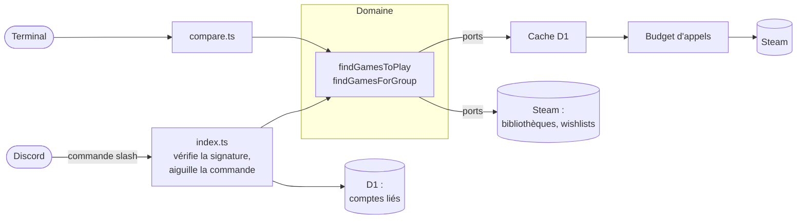

# 🎮 Coop Finder

**Le bot Discord qui trouve à quoi jouer entre amis.**
Il croise vos bibliothèques et vos listes de souhaits Steam, ne garde que les jeux multijoueur, et affiche les prix et les promos du moment. Le tout en une seule commande.

<!-- Capture d'écran d'un /groupe à ajouter : docs/groupe.png -->
<!--  -->

---

## Fonctionnalités

| Commande | Ce qu'elle fait |
|---|---|
| `/lier compte:<pseudo, URL ou SteamID>` | Associe ton compte Steam à ton compte Discord. À faire une seule fois. |
| `/jouer joueur:@ami` | Compare ton compte avec celui d'un ami. |
| `/groupe joueur1:@ami … joueur9:@ami` | Compare jusqu'à 10 personnes, toi compris. |
| `/delier` | Supprime l'association avec ton compte Steam. |

**`/jouer` répond avec quatre listes :**
- 🎮 les jeux **multi** que vous possédez tous les deux, par ordre alphabétique ;
- 🎁 les jeux que tu possèdes et que ton ami veut, et inversement, du moins cher au plus cher ;
- 💸 les jeux que vous voulez tous les deux, idéaux pour un achat groupé ;
- 🌐 quelques jeux gratuits jouables dans le navigateur, pour ne jamais rester sans idée.

**`/groupe` répond avec trois listes adaptées à un groupe :**
- 🎮 **Jouable par tout le monde** : possédé par tous les membres ;
- 🛒 **Il ne manque qu'une personne** : avec son nom et le prix du jeu ;
- 💸 **Envies communes** : présent dans au moins deux wishlists, les plus demandés d'abord.

Pour chaque jeu : prix actuel, réduction en cours, et mention « Accès anticipé » ou « Pas encore sorti » si besoin.

> **Prérequis pour chaque joueur** : un profil Steam dont la bibliothèque (« Détails des jeux ») et la liste de souhaits sont **publiques**.

---

## Stack technique

| Domaine | Choix |
|---|---|
| Langage | **TypeScript** (mode strict, `noUncheckedIndexedAccess`, `exactOptionalPropertyTypes`) |
| Bot | **Discord**, commandes slash en mode *interactions HTTP* |
| Hébergement | **Cloudflare Workers** (palier gratuit) |
| Base de données | **Cloudflare D1** (SQLite) : comptes liés et cache des détails de jeux |
| Données | **Steam Web API** et API du magasin Steam |
| Tests | **Vitest** |

Le projet est **100 % gratuit** à héberger et à utiliser.

---

## Architecture

Le projet suit une **architecture hexagonale** (ports et adaptateurs), guidée par les principes **SOLID** : la logique métier ne connaît ni Discord, ni Steam, ni Cloudflare.



- **`domain/`** : la logique pure. Croisements, filtre multijoueur, tri par prix. Entièrement testée, sans réseau.
- **`ports/`** : les contrats dont le domaine a besoin (`LibraryProvider`, `WishlistProvider`, `GameDetailsProvider`, `UserLinkRepository`…).
- **`adapters/`** : les implémentations concrètes. Steam, D1, des versions en mémoire pour les tests, et deux **décorateurs** :
  - `CachedGameDetailsProvider` consulte le cache D1 avant d'interroger Steam ;
  - `BudgetedGameDetailsProvider` limite les appels à Steam pour respecter la limite de 50 appels externes par requête du palier gratuit.
- **`discord/`** : les commandes slash, la mise en forme des messages et les réponses différées.
- **`index.ts`** et **`compare.ts`** : deux points d'entrée (Discord et terminal) qui branchent les adaptateurs sur le même service.

Grâce à ce découpage, ajouter une source de prix (IsThereAnyDeal), une plateforme (Epic, GOG) ou une interface (site web, Discord Activity) ne demande aucune modification du domaine.

### Structure du projet

```
src/
  domain/          logique métier pure : comparaisons, filtres, tris, services
  ports/           interfaces dont dépend le domaine
  adapters/
    steam/         appels à l'API Steam et traduction vers le domaine
    d1/            base de données D1
    memory/        versions en mémoire, pour les tests
    decorators/    cache et budget d'appels
  discord/         commandes, aiguillage, mise en forme des messages
  presentation/    éléments d'affichage partagés (prix, jeux gratuits)
  index.ts         point d'entrée du Worker Cloudflare
  compare.ts       point d'entrée en ligne de commande
tests/             mêmes dossiers que src/
migrations/        schéma de la base D1
scripts/           enregistrement des commandes Discord
```

---

## Installation

### Prérequis

- **Node.js 20** ou plus récent
- Une **clé API Steam** : [steamcommunity.com/dev/apikey](https://steamcommunity.com/dev/apikey)
- Un **compte Cloudflare** (gratuit)
- Une **application Discord** : [discord.com/developers/applications](https://discord.com/developers/applications)

### 1. Cloner et installer

```bash
git clone https://github.com/Dorian-Weber/coop-inder.git
cd coop-inder
npm install
```

### 2. Les variables d'environnement

Crée un fichier `.dev.vars` à la racine (il est ignoré par Git) :

```
DISCORD_APPLICATION_ID=
DISCORD_PUBLIC_KEY=
DISCORD_TOKEN=
DISCORD_GUILD_ID=          # un ou plusieurs identifiants de serveurs, séparés par des virgules
STEAM_API_KEY=
```

Pour le script en ligne de commande, crée aussi un `.env` avec `STEAM_API_KEY=` (voir `.env.example`).

### 3. La base de données

```bash
npx wrangler login
npx wrangler d1 create coop-finder
```

Reporte le `database_id` affiché dans `wrangler.toml`, puis crée les tables :

```bash
npx wrangler d1 migrations apply coop-finder --local
npx wrangler d1 migrations apply coop-finder --remote
npm run worker:types
```

### 4. Déployer

```bash
npx wrangler secret put DISCORD_PUBLIC_KEY
npx wrangler secret put DISCORD_APPLICATION_ID
npx wrangler secret put STEAM_API_KEY
npm run worker:deploy
```

Dans le portail développeur Discord, renseigne l'adresse affichée (`https://coop-finder.<sous-domaine>.workers.dev`) dans **Interactions Endpoint URL**.

### 5. Enregistrer les commandes et inviter le bot

```bash
npm run register
```

Invite le bot sur ton serveur depuis **OAuth2 → URL Generator**, avec les scopes `applications.commands` et `bot`.

---

## Scripts

| Commande | Rôle |
|---|---|
| `npm test` | Lance les tests (Vitest) |
| `npm run typecheck` | Vérifie les types de tout le projet |
| `npm run dev src/compare.ts <steamIdA> <steamIdB>` | Compare deux comptes depuis le terminal |
| `npm run worker:dev` | Lance le Worker en local |
| `npm run worker:deploy` | Déploie le Worker sur Cloudflare |
| `npm run worker:types` | Régénère les types de l'environnement Cloudflare |
| `npm run register` | Enregistre les commandes slash sur les serveurs de `DISCORD_GUILD_ID` |

---

## Tests

La logique est développée en **TDD** : **92 tests**, sans aucun appel réseau. Les sources de données sont remplacées par de faux fournisseurs, ce qui permet de tester tout l'enchaînement (récupération, croisements, enrichissement, filtrage, tri) en quelques millisecondes.

```bash
npm test
```

---

## Limites connues

- **Profils privés** : Steam ne renvoie rien pour une bibliothèque ou une wishlist privée.
- **50 appels externes par commande** sur le palier gratuit de Cloudflare. Pour un grand groupe ou de grosses bibliothèques, la première commande peut être incomplète (le message l'indique) ; le cache comble les manques dès les suivantes.
- **Prix en euros**, pour le magasin Steam français.
- **Messages limités à 2 000 caractères** : 10 jeux au maximum par section.

---

## Pistes d'évolution

- [ ] Plus bas historique et meilleurs prix toutes boutiques, via **IsThereAnyDeal**
- [ ] **Vote** avec des boutons sous le message pour choisir le jeu
- [ ] **Alertes** quand un jeu d'une wishlist commune passe en promo
- [ ] Commandes **globales**, disponibles sur tous les serveurs où le bot est installé
- [ ] **ESLint** et **intégration continue** GitHub Actions

---

## À propos

Projet personnel réalisé pour apprendre TypeScript, l'architecture logicielle et le déploiement serverless, et pour le partager avec mes amis.
